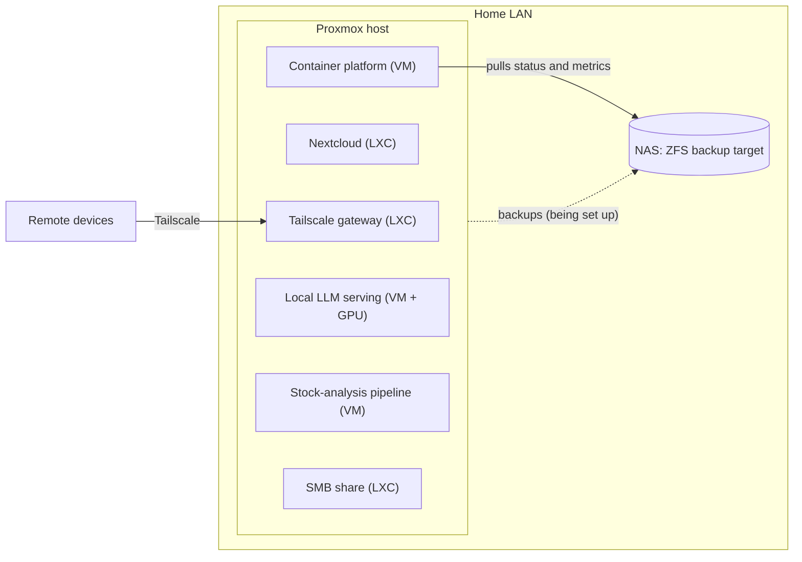

# homelab-infra

My home server setup: a Proxmox host that runs self-hosted services and local LLMs, and a separate ZFS-based NAS that serves as the backup target. It is a personal learning project.

## Why I built it

- Get hands-on networking and server administration experience at a small scale.
- Replace external subscriptions with local equivalents.
- Run my BIST stock-analysis pipeline on my own hardware.
- Run LLMs locally and switch between different models.
- Design long-running automations and data pipelines.
- Prepare the base for a smart-home setup.

## Overview

## What runs

| Part | What it does |
|---|---|
| Proxmox host | Repurposed X79 desktop platform: Xeon E5-2696 v2, 32 GB RAM, RTX 3060 12 GB passed through to the LLM VM |
| Tailscale gateway | Subnet router for remote access to the home network |
| Nextcloud | File sync for four users |
| Container platform | Coolify, hosting self-hosted apps such as git hosting, monitoring and PDF tools |
| Local LLM serving | GPU VM running vLLM and Ollama behind a single gateway |
| Stock-analysis pipeline | VM with a time-series database and object storage for my BIST analysis project |
| SMB share | Network file share |
| NAS | Separate ZFS machine for backups, with SMART and ZFS monitoring |

Two game-server guests also run on the host and are not documented here.

## Status

| Component | State |
|---|---|
| Proxmox host and services | Running |
| NAS (ZFS pools, monitoring, firewall, Wake-on-LAN) | Built |
| Backups from host to NAS | Being set up |
| 3D-printed NAS case (Fusion 360) | In design |

## Documents

- [`docs/architecture.md`](docs/architecture.md): layers, storage and remote access.
- [`docs/nas.md`](docs/nas.md): the NAS and the backup design.
