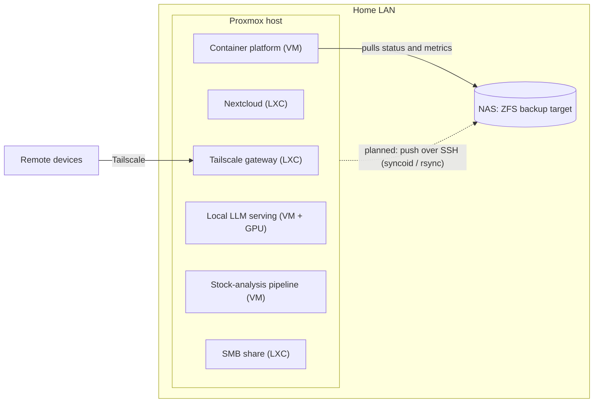

# homelab-infra

My home server setup: a Proxmox host that runs services, and a separate ZFS-based NAS that is meant to hold the backups. This repo explains how it is put together, why, and which parts are still unfinished.

It is a personal learning project at small scale, not a production system. Nothing here is benchmarked. Numbers are configuration facts or values reported by SMART/ZFS, and are labelled as such.

## Why I built it

- Get hands-on networking and server administration experience.
- Replace external subscriptions with local equivalents.
- Run my BIST stock-analysis pipeline on my own hardware.
- Run LLMs locally and switch between different models.
- Design long-running automations and data pipelines.
- Prepare the base for a smart-home setup.

## Overview

| Part | What it is |
|---|---|
| Host | Proxmox VE on a repurposed X79 desktop platform: Xeon E5-2696 v2, 32 GB RAM, RTX 3060 12 GB passed through to one VM |
| Guests | 8 VMs/LXCs. A Tailscale gateway, Nextcloud (4 users), a container platform hosting self-hosted apps, a GPU VM for local LLMs, a VM for the stock-analysis pipeline, an SMB share, and two game servers (not documented here) |
| NAS | Separate machine: ECS NM70-I2 Mini-ITX, Celeron 1037U, Debian 13, ZFS. Passive backup target |

## Status (31 Oct 2026)

| Component | State |
|---|---|
| Proxmox host and guests | Running. At the last audit (20 Oct) five guests were running and three were powered off |
| ZFS mirror on the host | Running, but one member reports read errors. Replacement not done |
| NAS: pools, snapshots, monitoring, firewall, Wake-on-LAN | Built and tested |
| Replication from Proxmox to NAS | **Not started** |
| Off-machine backup of host data | **None yet** |
| Alert delivery (ntfy / Telegram / mail) | Not chosen. Alerts go to the journal and a log file only |
| Remote access | Tailscale subnet router in a dedicated LXC |
| 3D-printed NAS case (6x 2.5" bays, Fusion 360) | In design |

Setup logs are kept on the machines and are not published.

## Documents

- [`docs/architecture.md`](docs/architecture.md): layers, storage tiers, what is lost if a disk fails, RAM budget.
- [`docs/nas-backup-design.md`](docs/nas-backup-design.md): push-only backup model, least-privilege permissions, monitoring, what was tested.
- [`docs/audit-and-lessons.md`](docs/audit-and-lessons.md): a self-audit of the host with findings that are still open, plus lessons from the build.

## Scope

Internal addresses, MAC addresses, disk serial numbers, port lists and firewall details are left out on purpose. Game servers are not covered.
